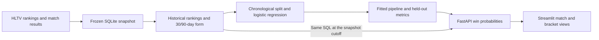
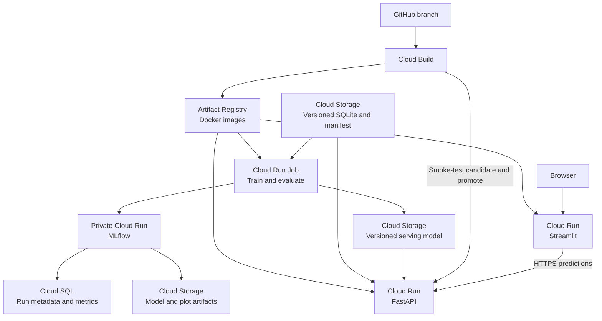

# CS2 Match and Tournament Predictor

**[Try the Streamlit app](https://cs2-streamlit-fd3amiehsa-uc.a.run.app)** · [Prediction API](https://cs2-predictor-fd3amiehsa-uc.a.run.app/docs) · [Model and snapshot status](https://cs2-predictor-fd3amiehsa-uc.a.run.app/health)

Choose two teams to see their match win probabilities. In **Tournament bracket**, seed eight teams in the quarterfinal dropdowns. The app highlights the winners in the most probable complete bracket and shows one table with each team's overall championship probability.

## How it works



- **Training.** SQLite builds ranking and points differences, recent match counts, and win rates using history before each match's start. The pipeline fits median imputation, scaling, and logistic regression on the earliest 70% of matches. The next 15% is validation and the last 15% is held-out test. Matches sharing a timestamp stay together.
- **Serving.** FastAPI builds features for the requested teams on demand using the same SQL at the frozen snapshot cutoff. The model scores one matchup and returns complementary probabilities in the requested team order. The API offers teams with at least five completed matches in the 30-day window before that cutoff.
- **Brackets.** Streamlit requests the 28 pairwise probabilities for the selected teams and evaluates all 128 possible brackets. It multiplies the seven match probabilities along each path, shows the path with the highest joint probability, and sums each team's winning paths for the championship table. This assumes a matchup's win probability stays fixed throughout the bracket.

## Google Cloud



Cloud Build resolves the selected branch to a commit. The training job downloads the snapshot generation in its manifest and verifies the SHA-256 before training. MLflow records the resolved config, split sizes, metrics, confusion matrix, and model export. A successful job also writes a serving bundle to Cloud Storage. The candidate API loads that model and data at startup. Cloud Build checks its commit, snapshot, and MLflow provenance before moving traffic. The Streamlit image is built separately from `app/Dockerfile`.

## Reproduce locally with Docker

Use Docker with BuildKit and Python 3 for the HTTP check. Run these commands in Bash on Linux, macOS, or WSL. The Git snapshot matches the cloud snapshot byte for byte. Docker fetches dependencies during the build, then training and serving use local files and need no cloud credentials.

### 1. Train on the frozen snapshot

```bash
git clone --branch cloud-mlops --depth 1 https://github.com/vagizD/cs2.git
cd cs2

docker build --platform linux/amd64 --target training \
  --build-arg GIT_COMMIT="$(git rev-parse HEAD)" -t cs2-training:repro .
mkdir -p artifacts/docker-repro/mlruns
docker run --rm --platform linux/amd64 --user "$(id -u):$(id -g)" \
  -v "$PWD/artifacts/docker-repro:/app/artifacts" \
  -v "$PWD/artifacts/docker-repro/mlruns:/app/mlruns" \
  -e MLFLOW_TRACKING_URI=sqlite:////app/artifacts/mlflow.db \
  cs2-training:repro sh -ec 'python -m ml.build_dataset --source local && python -m ml.train'
```

The dataset builder prints this line, followed by MLflow logs and a JSON training report.

```text
Built 16669 examples (SHA-256 cb066ad720c4386ea7ac9f383a10ca7628469e9ff589872d50033fa52f09294b).
```

| Split | Matches | Accuracy | ROC-AUC | Log loss | Brier score |
| --- | ---: | ---: | ---: | ---: | ---: |
| Train | 11,668 | | | | |
| Validation | 2,500 | 0.648400 | 0.689978 | 0.631286 | 0.220501 |
| Test | 2,501 | 0.649740 | 0.702383 | 0.625437 | 0.217786 |

The report includes the split dates and class counts. The verified Linux AMD64 model version is `logreg-049b8a1dcd903265`. Each training run has its own MLflow run ID. The feature CSV, fitted model, metadata, and local MLflow state are under `artifacts/docker-repro/`.

### 2. Run the prediction API

```bash
docker build --platform linux/amd64 --target runtime -t cs2-api:repro .
docker run --rm --platform linux/amd64 --read-only --tmpfs /tmp \
  -p 127.0.0.1:8080:8080 -e DATABASE_PATH=/snapshot.db -e MODEL_PATH=/model \
  -v "$PWD/data/processed/hltv_database.db:/snapshot.db:ro" \
  -v "$PWD/artifacts/docker-repro/model:/model:ro" cs2-api:repro
```

Run this check in a second terminal at the repository root.

```bash
python3 -m scripts.smoke_api http://127.0.0.1:8080 --wait-seconds 30 \
  --snapshot-version hltv-2026-09-08 --team-ids 4494 9565
```

The check prints JSON with `ready: true`, **43 eligible teams**, and this matchup. It also checks that the probabilities sum to one and swap when the team order is reversed.

| Team | ID | Win probability |
| --- | ---: | ---: |
| MOUZ | 4494 | 0.5234418238407702 |
| Vitality | 9565 | 0.4765581761592298 |

You can send other requests in the [local API docs](http://127.0.0.1:8080/docs). For a local Streamlit session, install `app/requirements.txt` in a Python 3.12 virtual environment and run `API_BASE_URL=http://127.0.0.1:8080 python -m streamlit run app/streamlit_app.py`.

## Snapshot and cloud releases

The September 8, 2026 snapshot contains 17,821 raw match records. The training set builder retains 16,669 completed series with valid scores. The frozen prediction cutoff is `2026-09-08T13:45:01Z`.

| Snapshot input | Value |
| --- | --- |
| Version | `hltv-2026-09-08` |
| GCS object | `gs://cs2_dataset/snapshots/hltv-2026-09-08/hltv_database.db` |
| GCS object generation | `1795310306177997` |
| SQLite SHA-256 | `9dc4989cba70c3d78ca650925fb7db625004784b8a6d9859d9818a05abf5fa00` |

Use `data/processed/hltv_database.db` from Git for the no-credentials Docker run. To check the private cloud copy, install `requirements/training.txt` in a Python 3.12 virtual environment and run the following with a Google account that can read the bucket. The downloader verifies the generation and SHA-256 against the manifest.

```bash
export GOOGLE_CLOUD_PROJECT=project-197ba5d4-68d9-4ad8-89e
export GCS_URI=gs://cs2_dataset/snapshots/hltv-2026-09-08/hltv_database.db
gcloud auth application-default login
python -m scripts.download_data
```

Maintainers with access to the provisioned project can submit training and API deployment with just a remote branch and a snapshot version. The command returns the Cloud Build ID and the release continues in Google Cloud.

```bash
export GCP_PROJECT=project-197ba5d4-68d9-4ad8-89e
export CS2_SNAPSHOT_BUCKET=cs2_dataset
bash scripts/release_cloud.sh cloud-mlops hltv-2026-09-08
```

The reference cloud run `30bbfc814ec745b79de57dd16eaf2823` matched the Docker feature checksum, all eight evaluation metrics, and the example prediction. Its serialized export has its own model version, `logreg-88029a3040c3ce1a`. [Training source commit](https://github.com/vagizD/cs2/commit/98d725893ce378487f2a8728de8fb6755906c2d8) · [Cloud Build rollout verification](https://console.cloud.google.com/cloud-build/builds;region=us-central1/76b8d077-4c10-4a69-83a1-125921f8f631?project=896802243269)

To refresh the data, build a fresh SQLite file locally and run `python -m scripts.upload_snapshot` with `DATABASE_PATH` pointing to it, a new `SNAPSHOT_VERSION`, and its matching `GCS_URI`. Then submit a release for that version. The uploader creates a new database object and manifest. The Streamlit service keeps calling the same API URL as new revisions are promoted.

Authorized viewers can open the private MLflow dashboard with the Google Cloud CLI and its Cloud Run proxy component.

```bash
gcloud run services proxy cs2-mlflow --project "$GCP_PROJECT" --region us-central1 --port 5000
```

Open [MLflow on localhost](http://127.0.0.1:5000) and select **cs2-match-predictor**. For one-time provisioning in another project, prepare an Artifact Registry repository, a snapshot bucket, and the initial predictor using `scripts/deploy_api.sh`. Then run `scripts/setup_cloud_mlops.sh` to provision the private tracking service and release identities. The Cloud SQL instance incurs charges while it runs.

<details>
<summary>Deploy a Streamlit code update</summary>

From a clean checkout of the committed app changes, build the new image and update the provisioned Streamlit service. Its `API_BASE_URL` is already configured.

```bash
region=us-central1
image="$region-docker.pkg.dev/$GCP_PROJECT/cs2-predictor/cs2-streamlit:git-$(git rev-parse --short=12 HEAD)"
gcloud builds submit app --config deploy/build-image.yaml \
  --project "$GCP_PROJECT" --region "$region" \
  --service-account "projects/$GCP_PROJECT/serviceAccounts/cs2-cloud-build@$GCP_PROJECT.iam.gserviceaccount.com" \
  --gcs-source-staging-dir "gs://$GCP_PROJECT-cs2-releases/build-source" \
  --substitutions "_IMAGE=$image"
gcloud run services update cs2-streamlit --project "$GCP_PROJECT" --region "$region" --image "$image"
```

</details>

## Limitations and source

The model is an educational baseline trained on frozen HLTV data, with no live roster or match-format inputs. Match start times are available, but result publication times are missing, so earlier matches that overlap a target match can introduce timing bias. Review the terms before collecting or redistributing source data. [HLTV](https://www.hltv.org/) · [HLTV terms](https://www.hltv.org/terms)

The previous roster dynamics study is archived on the [roster-analysis branch](https://github.com/vagizD/cs2/tree/roster-analysis).
